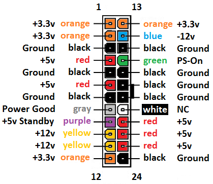
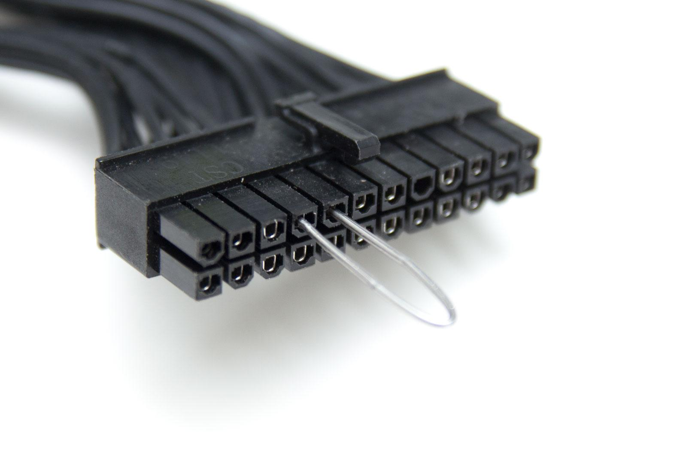
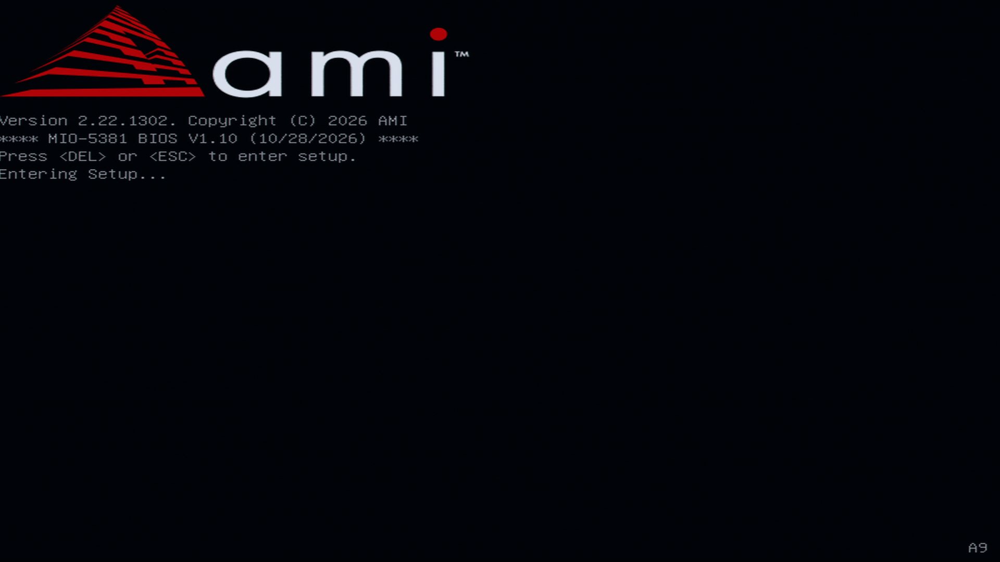
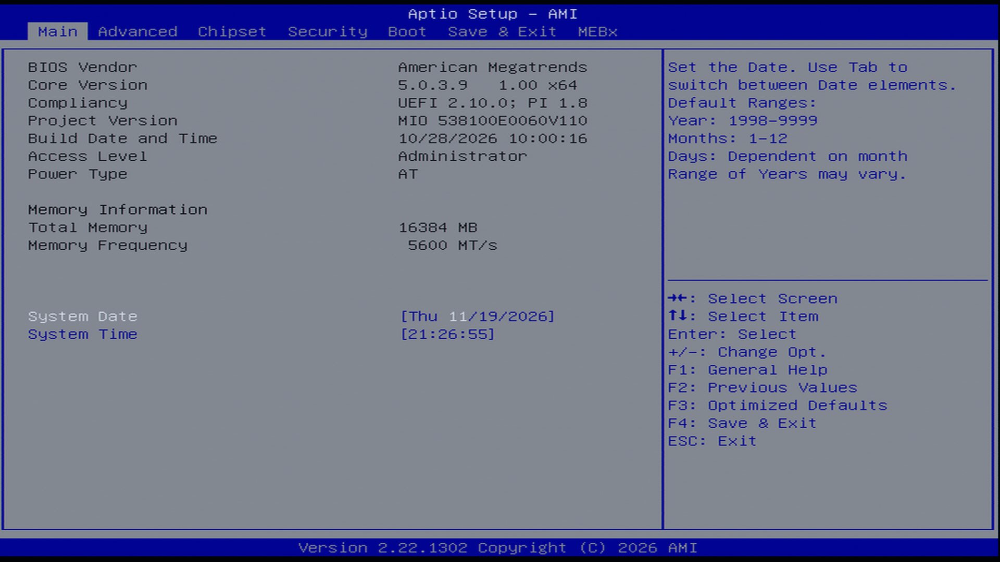

(advantech-mio-5381)=
# Advantech MIO-5381

## Product Link

**Product link**: [MIO-5381](https://www.advantech.com/en-us/products/bc6786b7-b69b-4fdd-9b63-79180dbd5dcb/mio-5381/mod_754471e8-aeff-493c-95b0-9eea2652e4ea)

## Overview

This guide describes how to set up the Advantech MIO-5381 development kit hardware and confirm that it powers on and boots correctly.

This kit is powered by the **Intel® Core™ Ultra X7 358H** processor. It consists of a compute module that hosts the processor, memory, and 100x 87 mm footprint.

There is a seperate GMSL AIC **SOM-CM10** This guide will also cover how to power the GMSL AIC.

## What you will need

- A monitor with and **HDMI**
- **USB Keybaord and mouse**
- **ATX Power supply** (90 watts) is what I recommend. This must ahve CPU connector that splits to 2x2.
- **Jumper Cables** for ATX Power supply

## Overall Flow

1. **Unbox and Inspect** the System.
2. **ATX Pin** Always On pin connection.
3. **SOM-CM10** Power connection
4. **Connect** The display, keyboard, mouse.
5. **Verify** the BIOS and confirm the kit boots.

## Steps

### Step 1. Unbox and inspect

Expected accessories in the shipment will be the following:

- **MIO-5381**.
- 2x COM RS-232 cables.
- Audio Cable.
- QFCS Active cooler
- Heatsink Passive.

### Step 2: ATX Pin

Grab your ATX power supply. 

:::caution
Please make sure that your power supply is not plugged in, and the switch is off
:::

1. Find the motherboard power connector. This is the 24 pin connector.

2. Grab your jumper cables, and attach them to the Green (PS ON) and black (GND) and example is shown in the images below.

  

The following image is with the jumper connected.

### Step 3: Connect preipherals.

Connect your monitor to the **HDMI** output, and plug a keyboard and mouse into the **USB** ports.

### Step 4: Power on

Grab the 2x2 CPU power cable and connect them to MIO-5381. This will result in the MIO-5381 fan kicking on. 

:::caution
If the Fan on the system does not turn on make sure your ATX power supply jumper are connected correctly. They should not fallout
or wobble.
:::

### Step 5: Verify the BIOS

1. Press **`Del`** key on the keyboard while the system is booting.

   

2. Check the **time**, **date**, and configuration settings.

   

## Next Steps

- **[GMSL](./interfaces/gmsl.md)** — review the operating systems validated for this kit before installing your OS.

:::{toctree}
:caption: Components
:hidden:
Supported Operating Systems <supported-operating-systems>
Interfaces <interfaces/index>
:::
