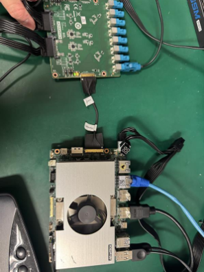
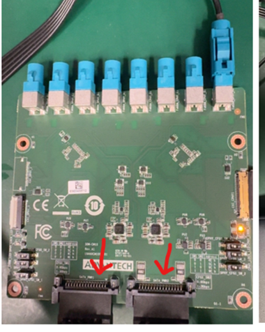
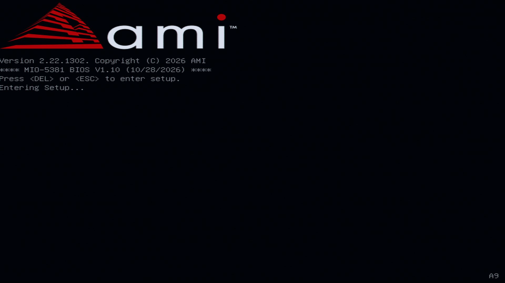
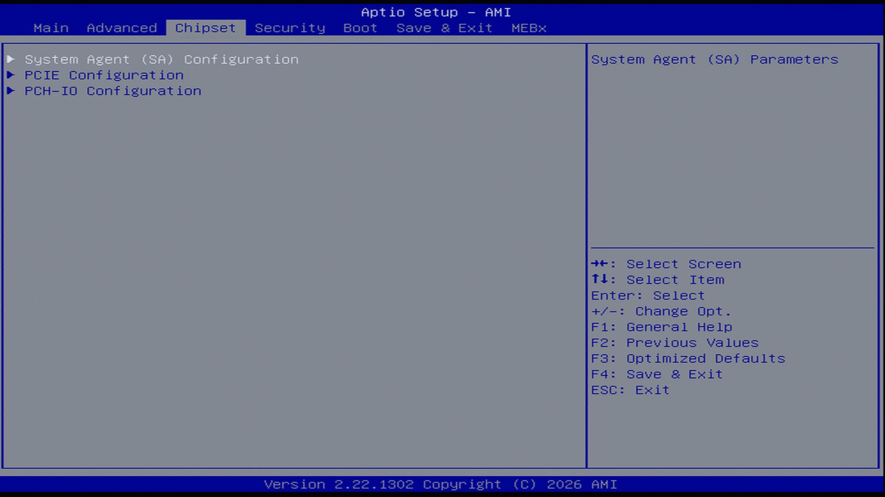
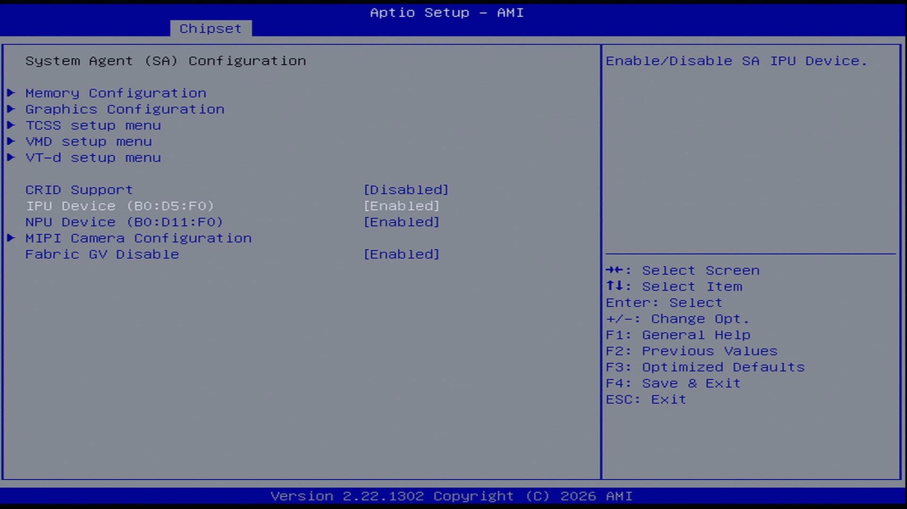
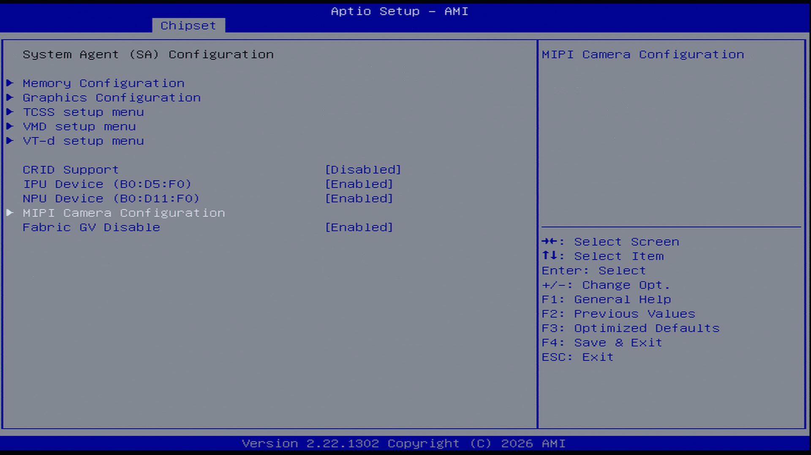
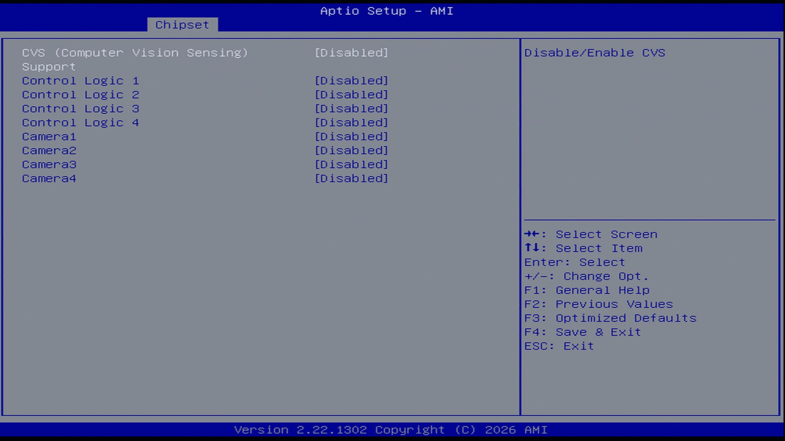

# GMSL

This guide covers connecting the **SOM-CM10** to **MIO-5381** for GMSL Cameras. Use of this interface requires software setup, including installing the Robotics AI Suite.

:::caution
Make Sure **MIO-CM10** is powered down.
:::

## Physical Connection

**MIO-5381** has two MIPI connectors we will be using MIPI 1 connector on the top.

The **SOM-CM10** AIC includes 4 CPHY GMSL connections board + 4 DPHY Connections on board

1. Connect MIPI **MIO-5381** to **SOM-CM10**

    

2. Connect SATA power to **SOM-CM10**

    

## BIOS Configuration

Power on the system.

1. Press **`Del`** key on the keyboard while the system is booting.

   

2. Enable IPU

   

   

3. Disable MIPI PDATA Cameras

   

   

4. Press `f4` to save and exit 

## Next steps

Use of this interface requires software setup, including installing the Robotics AI Suite. Make sure you've followed the [Getting Started](../../../getting_started.md) guide.

Once you've setup your ACPI GMSL settings for your camera, continue with [Step 2: GMSL Software Driver](../../../../components/sensors/cameras/gmsl/index.md#step-2-gmsl-software-driver)
